<div align="center">
  
  <h1>contributionDynamic</h1>
  <p><em>Beyond static contributions.</em></p>
  <p>Transform GitHub contribution calendars into animated worlds.</p>
  <a href="https://github.com/AndreaCarrilloOp/contributionDynamic/actions/workflows/ci.yml"></a>
  <a href="LICENSE"></a>
  
</div>

## Animated worlds

Five original animated worlds built from real GitHub contributions. Previews adapt to your appearance settings; the links below each animation open either theme directly.

### GitTanks

A golden tank clears contribution bricks, evades incoming fire and faces a continuous patrol of staggered silver reinforcements.

<picture>
  <source media="(prefers-color-scheme: dark)" srcset="https://raw.githubusercontent.com/AndreaCarrilloOp/contributionDynamic/output/tanks-dark.svg">
  
</picture>

<sub><a href="https://raw.githubusercontent.com/AndreaCarrilloOp/contributionDynamic/output/tanks-dark.svg">Dark Mode</a> · <a href="https://raw.githubusercontent.com/AndreaCarrilloOp/contributionDynamic/output/tanks-light.svg">Light Mode</a></sub>

### GitBlast

A pixel-art bomber clears a stone maze with cross-shaped blasts and roaming enemies that explore newly opened corridors while avoiding the flames.

<picture>
  <source media="(prefers-color-scheme: dark)" srcset="https://raw.githubusercontent.com/AndreaCarrilloOp/contributionDynamic/output/blast-dark.svg">
  
</picture>

<sub><a href="https://raw.githubusercontent.com/AndreaCarrilloOp/contributionDynamic/output/blast-dark.svg">Dark Mode</a> · <a href="https://raw.githubusercontent.com/AndreaCarrilloOp/contributionDynamic/output/blast-light.svg">Light Mode</a></sub>

### GitChess

Four chess attackers capture level-coded pieces using legal movement geometry and shared occupancy.

<picture>
  <source media="(prefers-color-scheme: dark)" srcset="https://raw.githubusercontent.com/AndreaCarrilloOp/contributionDynamic/output/chess-dark.svg">
  
</picture>

<sub><a href="https://raw.githubusercontent.com/AndreaCarrilloOp/contributionDynamic/output/chess-dark.svg">Dark Mode</a> · <a href="https://raw.githubusercontent.com/AndreaCarrilloOp/contributionDynamic/output/chess-light.svg">Light Mode</a></sub>

### GitInvaders

A single spaceship defends against aliens that oscillate within their own cells at a progressively faster arcade rhythm.

<picture>
  <source media="(prefers-color-scheme: dark)" srcset="https://raw.githubusercontent.com/AndreaCarrilloOp/contributionDynamic/output/invaders-dark.svg">
  
</picture>

<sub><a href="https://raw.githubusercontent.com/AndreaCarrilloOp/contributionDynamic/output/invaders-dark.svg">Dark Mode</a> · <a href="https://raw.githubusercontent.com/AndreaCarrilloOp/contributionDynamic/output/invaders-light.svg">Light Mode</a></sub>

### GitOrigami

Contribution cells fold into paper birds, fly and return to the calendar.

<picture>
  <source media="(prefers-color-scheme: dark)" srcset="https://raw.githubusercontent.com/AndreaCarrilloOp/contributionDynamic/output/origami-dark.svg">
  
</picture>

<sub><a href="https://raw.githubusercontent.com/AndreaCarrilloOp/contributionDynamic/output/origami-dark.svg">Dark Mode</a> · <a href="https://raw.githubusercontent.com/AndreaCarrilloOp/contributionDynamic/output/origami-light.svg">Light Mode</a></sub>

## Quick start

Requires Python 3.12+ and a GitHub token with read access to the intended contribution data. Set `GITHUB_TOKEN` securely in your environment.

```sh
git clone https://github.com/AndreaCarrilloOp/contributionDynamic.git
cd contributionDynamic
python -m pip install -e .
python -m contribution_dynamic batch --user YOUR_LOGIN --output-dir generated
```

Generate a single animation:

```sh
python -m contribution_dynamic generate --user YOUR_LOGIN --scenario invaders --theme dark --output invaders.svg
```

## GitHub Action

```yaml
- uses: AndreaCarrilloOp/contributionDynamic@main
  with:
    github-user: ${{ github.repository_owner }}
    github-token: ${{ secrets.CONTRIBUTION_TOKEN }}
    scenario: all
    theme: both
    output-dir: generated
```

Pin a reviewed release or commit SHA for production. The action generates files locally; publication is a separate step.

| Input | Default | Values |
| --- | --- | --- |
| `github-user` | — | GitHub login |
| `github-token` | — | Read-only token |
| `scenario` | `all` | all, tanks, blast, chess, invaders, origami |
| `theme` | `both` | both, dark, light |
| `output-dir` | `generated` | SVG destination |
| `signature` | `false` | true, false |

Set both the GitHub login and token for real contributions. Credential-free generation is available for local validation; public assets use live data only.

See the [profile setup guide](docs/setup.md) for a scheduled workflow and theme-aware README embedding.

## Architecture

`GitHub GraphQL` → `Calendar` → `Scenario planner` → `SVG` → `Output`

- No runtime dependencies, JavaScript or external sprites.
- Deterministic motion, preserved dates and activity levels.
- Ten live SVGs in [`output`](https://github.com/AndreaCarrilloOp/contributionDynamic/tree/output).
- Automated tests, linting, security checks and browser validation.

Animated SVGs require SMIL support. Published images expose dates, contribution counts and levels; review the intended visibility.

## Development

```sh
python -m pip install -e ".[dev]"
python -m pytest
python -m ruff check .
```

Generated test outputs and quality reports are not committed.

[Architecture](docs/architecture.md) · [Contributing](CONTRIBUTING.md) · [Security](SECURITY.md) · [MIT license](LICENSE)
