<div align="center">
  
  <h1>contributionDynamic</h1>
  <p><em>Beyond static contributions.</em></p>
  <p>Transform GitHub contribution calendars into animated worlds.</p>
  <a href="https://github.com/AndreaCarrilloOp/contributionDynamic/actions/workflows/ci.yml"></a>
  <a href="LICENSE"></a>
  
</div>

> Beta development · Prototype scenarios. Animated SVGs require a viewer that supports SMIL. The gallery uses the owner's published calendar; new assets appear after the publishing workflow succeeds.

## Gallery

### GitTanks

A golden retro tank navigates the contribution maze, breaks bricks before entering their cells, and faces up to three silver pursuers at a time. Hunters, ambushers and flankers spawn near standing bricks and navigate open cells with BFS. Both sides fire along clear rows or columns from up to five cells away. The eagle remains a visual base; the original calendar is restored when the tank returns to its starting square.

<picture>
  <source media="(prefers-color-scheme: dark)" srcset="https://raw.githubusercontent.com/AndreaCarrilloOp/contributionDynamic/output/tanks-dark.svg">
  
</picture>

[Dark SVG](https://raw.githubusercontent.com/AndreaCarrilloOp/contributionDynamic/output/tanks-dark.svg) · [Light SVG](https://raw.githubusercontent.com/AndreaCarrilloOp/contributionDynamic/output/tanks-light.svg)

### GitBlast

One arcade hero navigates free cells, plants a single bomb beside an intact contribution brick, and retreats before a cross-shaped explosion. Flames stop at the first brick in each direction. The calendar resets when the hero returns home.

<picture>
  <source media="(prefers-color-scheme: dark)" srcset="https://raw.githubusercontent.com/AndreaCarrilloOp/contributionDynamic/output/blast-dark.svg">
  
</picture>

[Dark SVG](https://raw.githubusercontent.com/AndreaCarrilloOp/contributionDynamic/output/blast-dark.svg) · [Light SVG](https://raw.githubusercontent.com/AndreaCarrilloOp/contributionDynamic/output/blast-light.svg)

### GitChess

One golden queen moves across a high-contrast wood-toned checkerboard, capturing ebony pieces that represent active contribution days. Activity levels map to pawn, knight, bishop and rook, with increasing piece size. The queen cannot pass through standing pieces; the calendar resets after she returns to her starting square. A clean, serif month header leaves the chessboard free of weekday labels.

<picture>
  <source media="(prefers-color-scheme: dark)" srcset="https://raw.githubusercontent.com/AndreaCarrilloOp/contributionDynamic/output/chess-dark.svg">
  
</picture>

[Dark SVG](https://raw.githubusercontent.com/AndreaCarrilloOp/contributionDynamic/output/chess-dark.svg) · [Light SVG](https://raw.githubusercontent.com/AndreaCarrilloOp/contributionDynamic/output/chess-light.svg)

### GitInvaders

A single pixel-art spaceship battles a colorful formation of contribution-powered aliens. Four original silhouettes encode activity levels. The ship evades enemy fire, clears each column from the bottom up, and the calendar restores at the end of the loop.

<picture>
  <source media="(prefers-color-scheme: dark)" srcset="https://raw.githubusercontent.com/AndreaCarrilloOp/contributionDynamic/output/invaders-dark.svg">
  
</picture>

[Dark SVG](https://raw.githubusercontent.com/AndreaCarrilloOp/contributionDynamic/output/invaders-dark.svg) · [Light SVG](https://raw.githubusercontent.com/AndreaCarrilloOp/contributionDynamic/output/invaders-light.svg)

### GitOrigami

Paper birds fold, fly, and restore the calendar.

<picture>
  <source media="(prefers-color-scheme: dark)" srcset="https://raw.githubusercontent.com/AndreaCarrilloOp/contributionDynamic/output/origami-dark.svg">
  
</picture>

[Dark SVG](https://raw.githubusercontent.com/AndreaCarrilloOp/contributionDynamic/output/origami-dark.svg) · [Light SVG](https://raw.githubusercontent.com/AndreaCarrilloOp/contributionDynamic/output/origami-light.svg)

## Quick start

Requires Python 3.12 or newer.

```sh
git clone https://github.com/AndreaCarrilloOp/contributionDynamic.git
cd contributionDynamic
python -m pip install -e .
python -m contribution_dynamic batch --output-dir generated
```

The default uses deterministic demo data. To fetch a live calendar, set the `GITHUB_TOKEN` environment variable securely and pass `--user YOUR_LOGIN`.

```sh
python -m contribution_dynamic generate --scenario invaders --theme dark --output invaders.svg
```

## GitHub Action

Add the following step to an Ubuntu workflow. Until a release is published, use `@main` for evaluation only; pin a verified release or commit SHA for production.

```yaml
- uses: AndreaCarrilloOp/contributionDynamic@main
  with:
    github-user: ${{ github.repository_owner }}
    github-token: ${{ secrets.CONTRIBUTION_TOKEN }}
    scenario: all
    theme: both
    output-dir: generated
```

| Input | Default | Options |
| --- | --- | --- |
| github-user | empty | GitHub login or demo |
| github-token | empty | Read-only token for live data |
| scenario | all | all, tanks, blast, chess, invaders, origami |
| theme | both | both, dark, light |
| output-dir | generated | Destination directory |

The action generates SVGs; it does not push changes. See the [setup guide](docs/setup.md) for a complete scheduled profile workflow and theme-aware embedding. Never commit tokens. Public SVGs disclose dates, counts and activity levels.

## Architecture

GraphQL collector → calendar model → scenario simulation → compact SVG → publication

- Dependency-free runtime engine and deterministic animation.
- Calendar positions and GitHub intensity levels preserved.
- Declarative SVG motion, no JavaScript or external sprites.
- Shared timeline compaction and batch generation from a single API request.

The experimental `motion` renderer remains available locally, but is not published. GitChess models queen movement and blocking, not a full chess game. GitOrigami is a geometric animation, not a physical folding solver.

## Development

```sh
python -m pip install -e ".[dev]"
python -m pytest -v
python -m ruff check .
```

[Architecture](docs/architecture.md) · [Contributing](CONTRIBUTING.md) · [Security](SECURITY.md) · [Changelog](CHANGELOG.md) · [MIT license](LICENSE)
